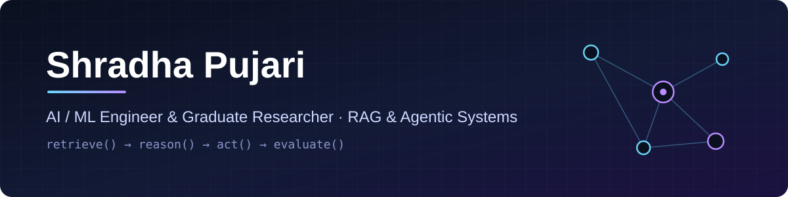

  

  🎓 M.S. Computer Science @ University of the Pacific &nbsp;·&nbsp; 🔬 Graduate Research Assistant &nbsp;·&nbsp; 🤖 President, Data Science & AI Club 
  📚 Leads a technical reading group for the MLOps Community &nbsp;·&nbsp; 🪧 Poster @ ACM CAIS 2026 (+17.2% retrieval quality)

<h3 align="center">🚀 Featured Work</h3>

<table>
  <tr>
    <td width="50%" valign="top">
      <b><a href="https://github.com/Shradhapujari/Adaptive-Multi-Agent-RAG-Architecture-for-Software-Ecosystem-Update-Monitoring">Adaptive Multi-Agent RAG</a></b> 
      Multi-agent retrieval architecture that monitors software-ecosystem updates, with an evaluation framework for agentic RAG.
    </td>
    <td width="50%" valign="top">
      <b><a href="https://github.com/Shradhapujari/WDL-Static-Risk">GenoRC · WDL-Static-Risk</a></b> 
      Static pre-execution checker that bounds the cost and privacy exposure of WDL genomics pipelines before they run.
    </td>
  </tr>
  <tr>
    <td width="50%" valign="top">
      <b><a href="https://github.com/Shradhapujari/DualBeat">DualBeat</a></b> 
      AI-powered cardiac intelligence platform — a clinical co-pilot built at an Anthropic-hosted build event.
    </td>
    <td width="50%" valign="top">
      <b><a href="https://github.com/Shradhapujari/ai-engineer-worlds-fair-2026-hackathon">Project OmniForge</a></b> 
      Continual-learning agent built on OpenHands at the AI Engineer World's Fair 2026 hackathon.
    </td>
  </tr>
  <tr>
    <td width="50%" valign="top">
      <b><a href="https://github.com/Shradhapujari/agentic-quantum-optimizer">Agentic Quantum Optimizer</a></b> 
      Agent-driven optimization experiments with Qiskit.
    </td>
    <td width="50%" valign="top">
      <b><a href="https://github.com/Shradhapujari/sjv-climatewatch.github.io">SJV ClimateWatch</a></b> 
      Live community climate & air-quality dashboard for the San Joaquin Valley (Highcharts, OpenAQ, Open-Meteo).
    </td>
  </tr>
</table>

<h3 align="center">⌨️ Programming Languages</h3>

  <table border="0"><tr>
    <td align="center"></td>
    <td align="center"></td>
    <td align="center"></td>
    <td align="center"></td>
    <td align="center"></td>
    <td align="center"></td>
  </tr></table>

<h3 align="center">🧠 AI / ML & Agents</h3>

  <table border="0"><tr>
    <td align="center"></td>
    <td align="center"></td>
    <td align="center"></td>
    <td align="center"></td>
    <td align="center"></td>
    <td align="center"></td>
    <td align="center"></td>
    <td align="center"></td>
    <td align="center"></td>
    <td align="center"></td>
  </tr></table>

<h3 align="center">📊 Data Science</h3>

  <table border="0"><tr>
    <td align="center"></td>
    <td align="center"></td>
    <td align="center"></td>
    <td align="center"></td>
    <td align="center"></td>
    <td align="center"></td>
  </tr></table>

<h3 align="center">🛠️ Tools & Platforms</h3>

  <table border="0"><tr>
    <td align="center"></td>
    <td align="center"></td>
    <td align="center"></td>
    <td align="center"></td>
    <td align="center"></td>
    <td align="center"></td>
    <td align="center"></td>
    <td align="center"></td>
  </tr></table>

<h3 align="center">📈 GitHub Stats</h3>

  
  
   
  

<h3 align="center">Thanks for stopping by — I'm happy to connect!</h3>

  <table border="0"><tr>
    <td align="center"></td>
    <td align="center"></td>
    <td align="center"></td>
  </tr></table>

